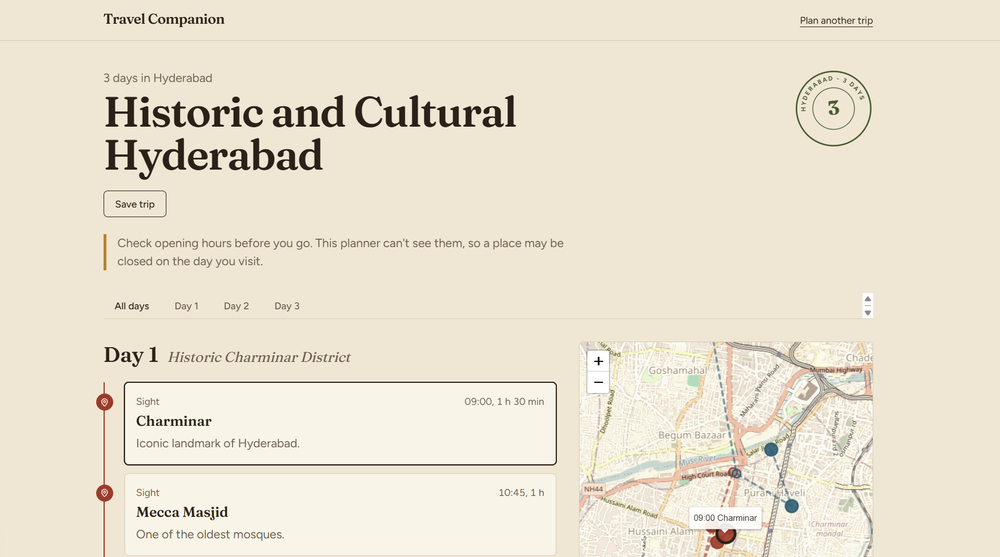

# AI Travel Planner

Pick a destination, trip length and travel style. The app builds a day-by-day itinerary with sights and restaurants, and shows it on a map.

**Live demo:** https://travel-companion-seven-gold.vercel.app



## The problem this solves

Asking an LLM for a travel plan gives you confident answers with closed restaurants, invented places, and days that zigzag across the city. This project treats the LLM as a planner, not a source of facts:

- Every place in the final itinerary is a real map result with a real ID and coordinates.
- Rules the model tends to ignore (a dinner every day, no zigzagging, a limit on museums) are enforced in code, not in the prompt.

## How it works

1. **Nominate.** The model suggests the famous must-see landmarks for the destination (names only).
2. **Verify.** Each name is looked up with the Geoapify geocoder. Names that don't resolve to a real place near the destination are dropped. Only verified results continue.
3. **Gather restaurants.** Restaurants are fetched around each landmark cluster, so a day in one neighbourhood has food options in that neighbourhood.
4. **Plan.** The model receives only the verified candidate list (using short ids like `p12`) and must build the itinerary from it. Anything it returns that isn't in the list is discarded.
5. **Validate in code.** The plan is checked against rules and re-requested with the specific problems listed if it fails (up to 3 attempts, best result kept):
   - 3 or 4 attractions per day, plus a lunch and a dinner at sensible times
   - at most 2 museums per day
   - no repeated places
   - stops within about 4 km of each other, under 10 km of total travel per day
   - no long empty gaps between daytime stops
   - at least 2 well-known landmarks per day when enough exist
6. **Display.** The itinerary is shown per day with a Leaflet map (OpenStreetMap tiles). Trips can be saved in the browser.

## Tech stack

- Next.js (App Router), TypeScript, Tailwind CSS
- Google Gemini API for planning and landmark suggestions
- Geoapify (OpenStreetMap-based) for geocoding and places
- Leaflet / react-leaflet for the map
- Zod for validating model output
- Deployed on Vercel

## Run locally

```bash
git clone <this repo>
cd travel-planner
npm install
```

Create `.env.local` (see `.env.example`):

```
GEMINI_API_KEY=
GEMINI_MODEL=
GEMINI_FALLBACK_MODEL=   # optional
GEOAPIFY_API_KEY=
```

Both providers have free tiers. Gemini model names change often; pick a current Flash or Flash-Lite model from Google AI Studio.

```bash
npm run dev
```

## Known limitations

- **Opening hours and closed days are not checked.** The data source doesn't provide them, so a plan can include a place that is closed that day.
- **No ratings or prices.** OpenStreetMap data doesn't include them, so the budget option only changes the style the model aims for. It is not a cost estimate.
- **Data quality varies by city.** Coverage is best in large, well-mapped cities.
- **Landmark suggestions are not deterministic.** The same request can produce different plans.
- **Slow.** A plan takes roughly 20 to 45 seconds because of multiple model calls and validation retries.
- **Free-tier dependence.** Model availability and rate limits on the free tier change; busy periods can cause errors.
- **Saved trips live in your browser** (`localStorage`). They don't sync between devices.
- **Rate limiting is in-memory** (5 plans per hour per IP), so it resets when the server restarts and is only a basic guard.

## Possible next steps

- Opening-hours data and day-of-week checks
- Accounts and a database for saved trips
- Persistent rate limiting and pre-generated sample trips
- Shareable trip links and export to calendar

## Development notes

Built with assistance from an AI model (Claude) for code and design discussion. Architecture decisions and testing were done by the author.
